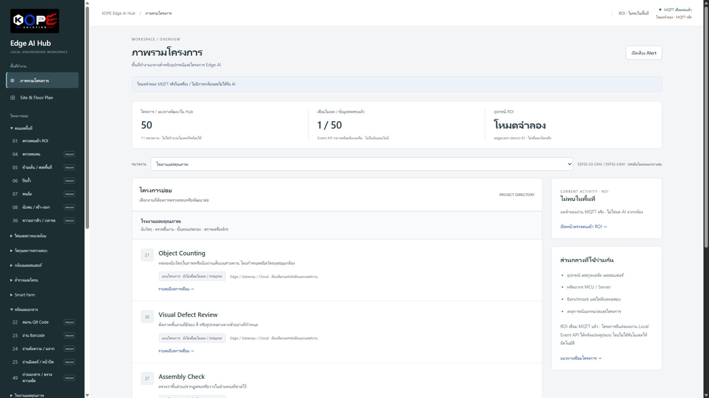

# Products & Software

ส่วนนี้รวบรวมทั้ง **Software showcase** และแนวทางพัฒนาผลิตภัณฑ์ Hardware ของ KOPE SOLUTION โดยแสดงสถานะ ข้อจำกัด และสิ่งที่ยังไม่พร้อมอย่างตรงไปตรงมา ไม่ใช่ร้านค้าและไม่มี cart, checkout, payment gateway, customer account, order database หรือ inventory system

## Featured software

<article class="product-feature-card">
  

    DEVELOPMENT PREVIEW / SOFTWARE
    <h2>KOPE Edge AI Hub</h2>
    
Local-first engineering workspace สำหรับจัดระเบียบโครงการ Edge AI, Site, Device, MQTT, ROI, Preview และ Processing plan ไว้ใน Hub เดียว

    <ul>
      <li>50 use-case plans ใน 11 หมวด — ไม่ใช่ 50 โมเดลพร้อมใช้</li>
      <li>วางแผน Device / Gateway / Cloud / Hybrid แยกรายโครงการ</li>
      <li>เปิดเผยขอบเขตโหมดจำลองและส่วนที่ยังไม่เชื่อมระบบจริง</li>
    </ul>
    <a class="md-button md-button--primary" href="kope-edge-ai-hub/">ดู KOPE Edge AI Hub</a>
  

  
</article>

!!! info "ช่องทางติดต่อสินค้าในเฟสแรก"
    ข้อความนี้ใช้กับ Hardware ที่อาจเปิดจำหน่ายในอนาคตเท่านั้น เมื่อมีสินค้าเปิดให้สอบถามหรือสั่งซื้อ จะใช้ **LINE Official Account ของ KOPE SOLUTION เพียงช่องทางเดียวในเฟสแรก** ขณะนี้ LINE URL/ID/QR code ยังเป็น placeholder และยังไม่มีการเปิดรับคำสั่งซื้อบนเว็บไซต์

<a class="md-button md-button--primary" href="../contact/#line">ดูสถานะช่องทาง LINE</a>

## Product categories

  
<h3>Software & Edge Platforms</h3>
Dashboard, engineering workspace และเครื่องมือช่วยจัดระบบการพัฒนา

  
<h3>IoT Devices</h3>
อุปกรณ์เชื่อมต่อและส่งข้อมูล

  
<h3>Sensor Nodes</h3>
หน่วยตรวจวัดภาคสนาม

  
<h3>Notification Devices</h3>
อุปกรณ์แสดงผลและแจ้งเตือน

  
<h3>Learning Kits</h3>
ชุดเรียนรู้ด้าน embedded และ electronics

  
<h3>PCB Modules</h3>
โมดูลวงจรสำหรับนำไปต่อยอด

  
<h3>Smart Home Devices</h3>
อุปกรณ์สำหรับบ้านอัจฉริยะ

  
<h3>Smart Farm Devices</h3>
อุปกรณ์สำหรับการตรวจวัดและระบบฟาร์ม

  
<h3>Industrial Accessories</h3>
อุปกรณ์ประกอบสำหรับระบบอุตสาหกรรม

  
<h3>Electronic Accessories</h3>
อุปกรณ์ประกอบทางอิเล็กทรอนิกส์

## Product status badges

  Concept
  Prototype
  Testing
  Coming Soon
  Pre-order
  Available
  Out of Stock
  Discontinued

Badge เป็นตัวเลือกที่รองรับ ไม่ได้แสดงสถานะสินค้าจริงจนกว่าเจ้าของจะยืนยัน

## Hardware concept

  Concept · Placeholder
  <h3><a href="notification-lamp-mini/">Notification Lamp Mini</a></h3>
  
ตัวอย่างหน้า product page ที่ครบทุก field แต่ยังไม่มีราคา stock สเปก certification หรือ marketplace URL จริง

Hardware package สำหรับ KOPE Edge AI Hub ยังอยู่ระหว่างเปรียบเทียบ reference board, กล้อง, carrier, power และ enclosure จึงยังไม่เพิ่มสินค้า ราคา หรือปุ่มสั่งซื้อจนกว่าจะผ่านการทดสอบตัวอย่างจริง

[ใช้ Product page template →](../templates/product-page.md)

