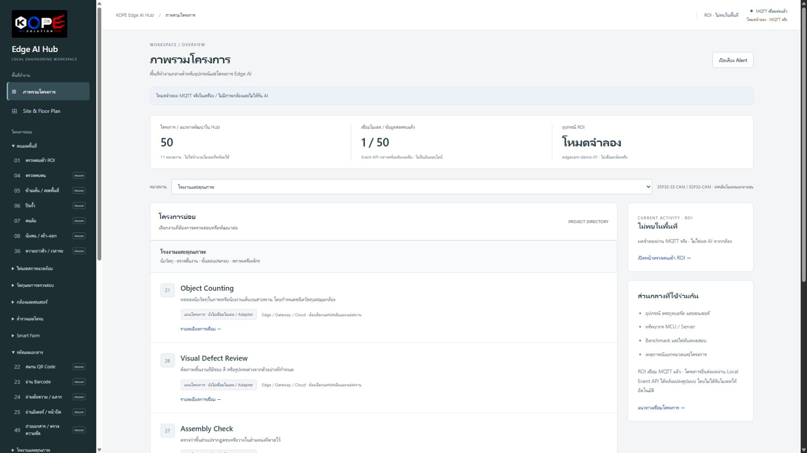
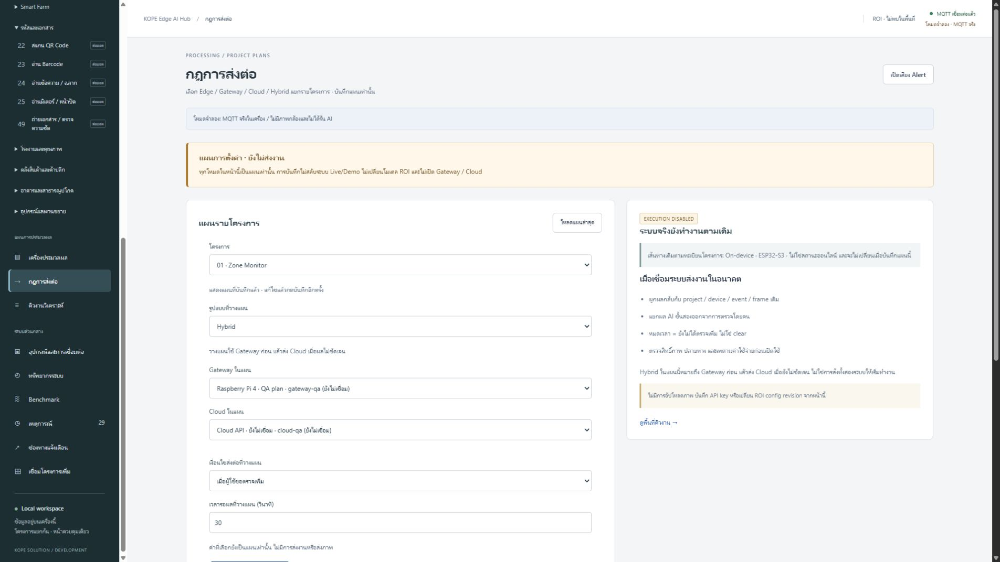

# KOPE Edge AI Hub

Development Preview

KOPE Edge AI Hub เป็นโครงการซอฟต์แวร์สำหรับจัดระเบียบการพัฒนา Edge AI ตั้งแต่ Site, Device, MQTT, ROI, Preview, Project catalogue ไปจนถึงแผนการประมวลผลแบบ Edge / Gateway / Cloud / Hybrid

[ดู Software showcase →](../products/kope-edge-ai-hub.md)

## Current phase

**Prototype / Development Preview — อัปเดต 8 พฤศจิกายน 2026**

หน้า Hub และ workflow หลักสามารถสาธิตใน local environment ได้แล้ว ส่วนการทำให้เป็นผลิตภัณฑ์ที่ติดตั้งให้ผู้อื่นใช้งานได้จริงยังต้องออกแบบ authentication, deployment, update, support และ hardware package เพิ่มเติม

## Objectives

- ทำให้โครงการ Edge AI มองเห็นทั้งอุปกรณ์ พื้นที่ ข้อมูล และข้อจำกัดในหน้าเดียว
- แยก use case ที่เป็นแนวคิดออกจาก integration ที่ทำงานแล้วอย่างชัดเจน
- วาง contract สำหรับ MQTT, Event, ROI และ Preview ที่ตรวจสอบย้อนหลังได้
- ช่วยเลือกจุดประมวลผลบน Device, Gateway, Cloud หรือ Hybrid ตามข้อจำกัดจริง
- เก็บหลักฐานการทดลองโดยไม่สรุปผลเกินข้อมูลที่วัดได้

## Milestones

| Milestone | Status | Evidence |
| --- | --- | --- |
| Local dashboard และ navigation | Done | หน้าภาพรวม, Site, Device และโมดูลโครงการเปิดใช้งานใน local preview |
| Project catalogue 50 แนวทาง / 11 หมวด | Done as planning catalogue | แต่ละรายการระบุว่าเป็นแผนหรือมี integration ระดับใด |
| Processing plan รายโครงการ | Prototype | บันทึกแผน Edge / Gateway / Cloud / Hybrid ได้ แต่ execution ยังปิด |
| Public demo และ release package | Not started | ยังไม่มี URL หรือไฟล์ดาวน์โหลดสำหรับผู้ใช้ภายนอก |
| Hardware reference และ enclosure | Research | ยังไม่เลือกบอร์ด กล้อง carrier, power หรือ package สำหรับจำหน่าย |

## Technical stack

- Node.js 22 ขึ้นไป
- MQTT.js 5.16.1
- Aedes 1.2.0 สำหรับ broker ทางเลือกในเครือข่ายทดสอบ
- Leaflet 1.9.4 สำหรับ Site / Floor plan
- HTML, CSS และ JavaScript แบบ static assets ไม่มี frontend framework runtime
- งานเชื่อม ESP32-S3 CAM ใช้ Rust และ ESP-IDF/C components ใน learning lab แยกต่างหาก

## Repository

[KOPE-SOLUTION/esp32s3-cam-rust-edge-ai-lab](https://github.com/KOPE-SOLUTION/esp32s3-cam-rust-edge-ai-lab)

Public repository ขณะนี้เป็น learning lab หลัก ส่วน source ของ Edge AI Hub ที่เห็นในภาพยังอยู่ระหว่างจัดระเบียบและยังไม่ประกาศเป็น public release

## Progress

หน้า Overview แสดง catalogue และสถานะของแนวทางแต่ละรายการ โดยติดป้ายโหมดจำลองชัดเจนเพื่อไม่ให้เข้าใจว่าเป็นผลจากอุปกรณ์จริง

หน้า Processing plan ใช้ช่วยคิดสถาปัตยกรรม แต่ไม่ส่งงานไป Gateway หรือ Cloud จริงในเวอร์ชันนี้

## Known issues and boundaries

- ยังไม่มี public deployment และยังไม่ควรเปิด local server ออก Internet
- หน้า Users / Roles เป็น UI planning ไม่ใช่ authentication หรือ RBAC จริง
- โครงการใน catalogue ส่วนใหญ่ยังไม่มีโมเดลหรือ adapter ที่พร้อมใช้
- ผลจากโหมดจำลองใช้ตรวจ UI และ data flow ไม่ใช่ผล benchmark ของ ESP32
- Hardware, กล้อง และ pin mapping ต้องทดสอบแยกตามบอร์ดจริง
- ยังไม่มี installer, auto-update, commercial license, SLA หรือ warranty

## Next steps

1. จัด source และเอกสารสำหรับ public development preview
2. เลือก hardware reference 2–4 แบบเพื่อทดสอบด้วย test matrix เดียวกัน
3. วาง baseline ของ camera, power, thermal, Wi-Fi และ enclosure
4. เชื่อม project workflow กับหลักฐานการทดสอบและ version ของ firmware
5. กำหนดขอบเขต Community edition, Integration service และ hardware package ก่อนประกาศราคา
