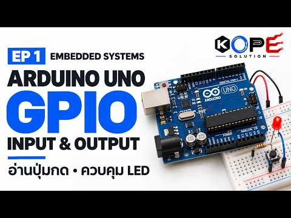
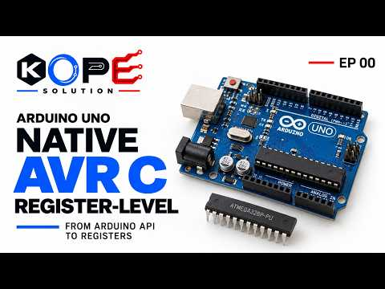
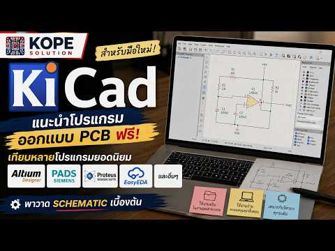
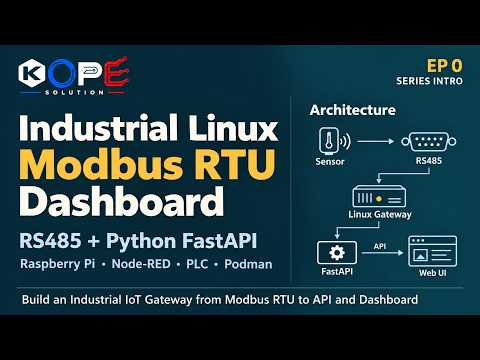
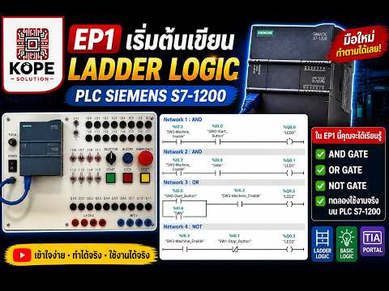
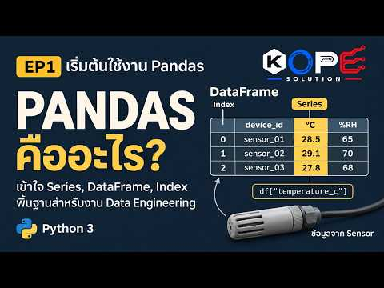
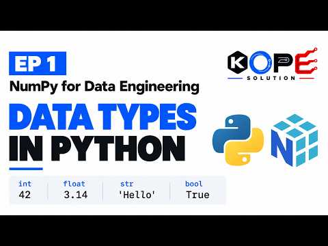
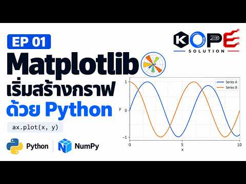

<section class="youtube-hero">
  

    
KOPE SOLUTION / WATCH · BUILD · REVIEW

    <h1>เรียนจากงานที่ลงมือทำจริง</h1>
    
รวมวิดีโอภาษาไทยและ Playlist แบบต่อเนื่อง ตั้งแต่ Embedded Systems, PLC และ Industrial IoT ไปจนถึง Data Engineering และ Machine Learning

    

      <a class="youtube-action youtube-action--primary" href="https://www.youtube.com/@KOPESOLUTION?sub_confirmation=1">ติดตามช่อง YouTube ↗</a>
      <a class="youtube-action" href="#playlists">เลือก Playlist</a>
    

    <dl class="youtube-hero__facts">
      
<dt>รูปแบบ</dt><dd>Series + Project</dd>

      
<dt>ภาษา</dt><dd>ไทย / Technical English</dd>

      
<dt>แนวทาง</dt><dd>อธิบาย · ทดลอง · ทบทวน</dd>

    </dl>
  

  

    

      <iframe src="https://www.youtube-nocookie.com/embed/C0Z1KjVDiss" title="สอน Machine Learning EP7: Naive Bayes จำแนกข้อความด้วย Python และ Bag-of-Words" loading="lazy" referrerpolicy="strict-origin-when-cross-origin" allow="accelerometer; autoplay; clipboard-write; encrypted-media; gyroscope; picture-in-picture; web-share" allowfullscreen></iframe>
    

    
LATEST SERIES
Machine Learning ด้วย Python · ตอนที่ 7
<small>Naive Bayes · Bag-of-Words · Text Classification</small>

  

</section>

<nav class="youtube-page-nav" aria-label="หัวข้อในหน้า YouTube">
  <a href="#latest">วิดีโอล่าสุด</a>
  <a href="#playlists">เส้นทางเรียนรู้</a>
  <a href="#embedded">Embedded</a>
  <a href="#industrial">Industrial</a>
  <a href="#data-ai">Data & AI</a>
  <a href="adding-content/">คู่มือเพิ่มเนื้อหา</a>
</nav>

<section id="latest" class="youtube-section">
  <header class="youtube-section__head">
01 / RECENT RELEASES
<h2>Machine Learning series ล่าสุด</h2>ชื่อและลิงก์ดึงจากช่องสาธารณะของ KOPE SOLUTION</header>
  

    <a href="https://www.youtube.com/watch?v=C0Z1KjVDiss"><b>EP07</b><strong>Naive Bayes จำแนกข้อความด้วย Python และ Bag-of-Words</strong><small>Text classification · 52:33</small><em>ดูวิดีโอ ↗</em></a>
    <a href="https://www.youtube.com/watch?v=gZJazzxvOY8"><b>EP06</b><strong>Ridge Regression และ L2 | Feature Engineering ด้วย Python</strong><small>Regression · 1:30:16</small><em>ดูวิดีโอ ↗</em></a>
    <a href="https://www.youtube.com/watch?v=0vM8L5NT2HQ"><b>EP05</b><strong>Linear Regression | MAE, RMSE, R² และกราฟ Residual</strong><small>Model evaluation · 1:05:55</small><em>ดูวิดีโอ ↗</em></a>
    <a href="https://www.youtube.com/watch?v=h0etS97NfDk"><b>EP04</b><strong>Logistic Regression, Confusion Matrix และ F1 Score</strong><small>Classification · 1:13:01</small><em>ดูวิดีโอ ↗</em></a>
  

</section>

<section id="playlists" class="youtube-section">
  <header class="youtube-section__head">
02 / LEARNING PATHS
<h2>เลือกเส้นทาง แล้วเรียนต่อเนื่อง</h2>คัด Playlist ที่เชื่อมกับแกนความรู้และโครงการของ KOPE SOLUTION</header>

  <h3 id="embedded" class="youtube-category-title">02.1 Embedded & Hardware</h3>
  

    <a class="youtube-playlist" href="https://www.youtube.com/playlist?list=PLtB6tPOso1cZgdFNqlBvlsjT8Y-Qvfhbe">09 VIDEOS · EMBEDDED<strong>Arduino Uno Embedded Systems</strong><small>Beginner to Embedded Engineer</small><i>เปิด Playlist ↗</i></a>
    <a class="youtube-playlist" href="https://www.youtube.com/playlist?list=PLYAiLito8owg">03 VIDEOS · REGISTER LEVEL<strong>Arduino Uno Native AVR C</strong><small>Register-Level Embedded Systems</small><i>เปิด Playlist ↗</i></a>
    <a class="youtube-playlist" href="https://www.youtube.com/playlist?list=PLtB6tPOso1cZ_PGpnMb0TgN9P-1ghowXj">05 VIDEOS · ESP-IDF<strong>ESP32-S3 Notification Solutions</strong><small>ESP-IDF Demo · KOPE SOLUTION</small><i>เปิด Playlist ↗</i></a>
    <a class="youtube-playlist" href="https://www.youtube.com/playlist?list=PLCM2RosA-mfM">01 VIDEO · HARDWARE<strong>PCB Design with KiCAD</strong><small>จากวงจรไปสู่การออกแบบบอร์ด</small><i>เปิด Playlist ↗</i></a>
  

  <h3 id="industrial" class="youtube-category-title">02.2 Industrial & Automation</h3>
  

    <a class="youtube-playlist" href="https://www.youtube.com/playlist?list=PLIyLY75_Ohwc">08 VIDEOS · MODBUS<strong>Industrial Linux Modbus RTU Dashboard</strong><small>Python · FastAPI · Industrial data</small><i>เปิด Playlist ↗</i></a>
    <a class="youtube-playlist" href="https://www.youtube.com/playlist?list=PLtB6tPOso1cYYRhZ5ea549GqAEc5Uju3M">20 VIDEOS · PLC / IIOT<strong>PLC Programming Roadmap</strong><small>Beginner to IIoT Engineer</small><i>เปิด Playlist ↗</i></a>
  

  <h3 id="data-ai" class="youtube-category-title">02.3 Data & Artificial Intelligence</h3>
  

    <a class="youtube-playlist" href="https://www.youtube.com/playlist?list=PLH6EFEqbyT6g">08 VIDEOS · MACHINE LEARNING<strong>Machine Learning ด้วย Python</strong><small>เริ่มต้นกับ scikit-learn</small><i>เปิด Playlist ↗</i></a>
    <a class="youtube-playlist" href="https://www.youtube.com/playlist?list=PLtB6tPOso1cY5OS1uyQjvrktkA-rHw2pU">12 VIDEOS · DATA ENGINEERING<strong>Pandas สำหรับ Data Engineering</strong><small>Data Analysis · Time-Series · IoT</small><i>เปิด Playlist ↗</i></a>
    <a class="youtube-playlist" href="https://www.youtube.com/playlist?list=PLtB6tPOso1cYC_CP2LQSj7JlY2_SAAYO3">09 VIDEOS · NUMPY<strong>NumPy for Data Engineering</strong><small>From Basics to Real-World Use</small><i>เปิด Playlist ↗</i></a>
    <a class="youtube-playlist" href="https://www.youtube.com/playlist?list=PLea-bfI_jPIA">14 VIDEOS · VISUALIZATION<strong>Python Data Visualization</strong><small>Matplotlib · Graphs · Geographic data</small><i>เปิด Playlist ↗</i></a>
  

</section>

<section class="youtube-section" aria-labelledby="youtube-share-title">
  <header class="youtube-section__head">
03 / SHARE
<h2 id="youtube-share-title">ส่งต่อเส้นทางเรียนรู้</h2>แชร์หน้ารวม Playlist เพื่อให้ผู้รับเลือกหัวข้อที่เหมาะกับตนเอง</header>
  

    <a class="share-facebook" href="https://www.facebook.com/sharer/sharer.php?u=https%3A%2F%2Fkope-solution.github.io%2Fknowledge-hub%2Fyoutube%2F" target="_blank" rel="noopener noreferrer">Facebook</a>
    <a class="share-line" href="https://social-plugins.line.me/lineit/share?url=https%3A%2F%2Fkope-solution.github.io%2Fknowledge-hub%2Fyoutube%2F" target="_blank" rel="noopener noreferrer">LINE</a>
    <a class="share-linkedin" href="https://www.linkedin.com/sharing/share-offsite/?url=https%3A%2F%2Fkope-solution.github.io%2Fknowledge-hub%2Fyoutube%2F" target="_blank" rel="noopener noreferrer">LinkedIn</a>
    <a class="share-x" href="https://twitter.com/intent/tweet?url=https%3A%2F%2Fkope-solution.github.io%2Fknowledge-hub%2Fyoutube%2F&amp;text=KOPE%20SOLUTION%20YouTube%20Studio" target="_blank" rel="noopener noreferrer">X</a>
  

</section>

<section class="youtube-channel-cta">
  

YOUTUBE / @KOPESOLUTION
<h2>ติดตามตอนใหม่จากช่องจริง</h2>หน้าเว็บไซต์นี้เป็นสารบัญคัดสรร ส่วนวิดีโอและ Playlist ฉบับเต็มเผยแพร่บน YouTube

  <a href="https://www.youtube.com/@KOPESOLUTION">เปิดช่อง KOPE SOLUTION ↗</a>
</section>
